### ✧･ﾟ: ✧ 　 Ciallo～(∠・ω< )⌒★) 　 ✧ ･ﾟ✧

`Web Frontend Developer` · You can call me `Maiko` (Note: `T` in `Tan` is a [nonaspirated /t/](https://en.wikipedia.org/wiki/Aspirated_consonant))

😊 Anime & manga · 🎮 [Final Fantasy XIV](https://eu.finalfantasyxiv.com/lodestone/character/22701817/) · 🏡 China

### 📊 My GitHub Stats

| | |
| :-: | :-: |
|  |  |
|  |  |

